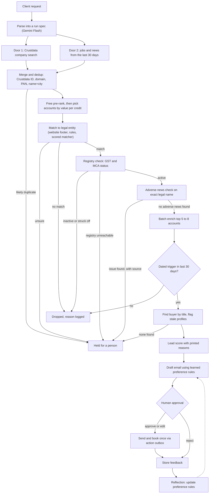
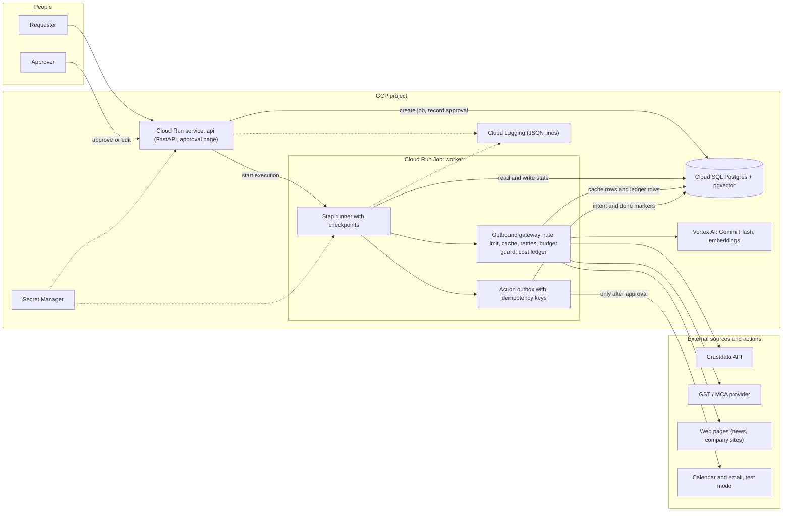

ContextCon 05 · Revenue track · working blueprint

# 3PL Revenue Agent Blueprint

The service finds Indian companies that need a 3PL partner, proves each one is real and safe to approach, finds a fresh reason and the right person, drafts outreach for human approval, and books the meeting exactly once. Every fact carries a source, or the answer is "cannot verify".

Modular monolith on Cloud Run One Postgres (state, ledger, evidence, vectors) Hybrid funnel + trigger search LLM parses, extracts, drafts. Code decides and spends. Target ≈ ₹1,800–2,200 per job

Part 1

## The research flow

Cheap checks come first, and expensive ones run only on accounts that survive. Every gate has three exits: continue, drop with a reason, or hold for a person when the sources can't settle it.



continueheld for a person (cannot verify)dropped with reason

### Stage by stage

| Stage | What happens | Source | Credits (est.) | When sources fail |
| --- | --- | --- | --- | --- |
| 0 · Parse | Request becomes a typed spec: industry, size, region, trigger types, buyer titles, cost and time limits. | Gemini Flash, schema-locked JSON | 0 (≈ ₹0.2) | Spec fails validation: ask the requester. |
| 1 · Find | Door 1 searches companies by filters. Door 2 searches job posts and news dated in the window. | Crustdata search, job search, web search | 10–20 | Empty matches are a valid result, not an error. |
| 2 · Dedup + pick | Merge records on strong keys, then rank on fields we already have and spend by expected value per credit. | Local | 0 | held possible duplicates. |
| 3 · Identity | Get the legal name from the website footer or privacy page, then match it to the registry record. | Web fetch, GST/MCA provider | 5–10 | cannot verify when the score lands in the middle band. |
| 4 · Registry | GSTIN active, legal name, state. MCA status: active or struck off. | GST/MCA provider | ₹ per call | cannot verify: registry unavailable |
| 5 · Adverse news | Quoted legal name plus risk words. Fetch each page, confirm the name is in the text, read `datePublished`. | Crustdata news, web search and fetch | 10–20 | Report "no adverse news found", never "clean". |
| 6 · Enrich | Shortlist only, 5 per call: news, hiring, headcount, decision-makers. | Crustdata enrich | 15–25 | 0, null and empty all count as unknown. |
| 7 · Trigger | At least one dated signal inside 30 days, classified by type. | Enrich news and jobs | 0 | dropped when no fresh trigger exists. |
| 8 · Buyer | Person search by title, then the enrich decision-maker list filtered by title. | Crustdata people | 5–15 | cannot verify buyer |
| 9 · Score + draft | Points score with reasons. Draft uses preference rules plus similar approved emails. | Local + Gemini | 0 (≈ ₹2–5) | Draft always waits for approval. |
| 10 · Act | After approval: send and create the calendar event with a deterministic ID. | Calendar and email in test mode | 0 | Outbox retries safely after a kill. |

Credit ranges are rough estimates from the probe (1 credit = $0.30 ≈ ₹25). Measure them with the ledger on the golden set before quoting a price.

Part 2

## Deployment architecture

One codebase builds one container image. The image runs as a web service (request intake, approval page, evidence viewer) and as a job (the pipeline). Postgres is the single source of truth, so either process can die at any time and the next start picks up from the last checkpoint.



### Why this survives the kill on stage

- Each step writes its result and a `done` marker in one transaction. On restart the runner skips finished steps.
- Every outside call goes through the gateway. Its request-hash cache means a replay costs ₹0 and returns the same evidence.
- Actions are written as intent first, with key = hash(job, account, action). The send runs only if no `done` marker exists, and the calendar event ID is that same key, so a second create is rejected.

### Where the brief's checkpoints sit

- **Data calls, retries, cost ledger:** the outbound gateway.
- **Approvals:** the API writes them, and the outbox reads them before acting.
- **Logs:** JSON to stdout, tagged with job, account and step, collected by Cloud Logging.
- **Hour-3 change and live fix:** `config.yaml` (limits, windows, thresholds, output fields) plus Pydantic output models.

### Package layout

```
app/
  spec/          request → run spec (LLM)
  discovery/     door 1 + door 2, dedup
  identity/      legal-entity matching
  trust/         registry + adverse news
  revenue/       trigger, buyer, score
  outreach/      draft, preference learning
  actions/       outbox, calendar, email
  gateway/       rate limit, cache, ledger
  evidence/      Fact model, citations
  runner/        steps, checkpoints
  api/           FastAPI + approval page
config.yaml
tests/golden/    hard cases from the probe
```

### Postgres tables

```
jobs          id, spec, status, limits
steps         job, account, step, status, output
accounts      merged entity, keys, verdicts
evidence      url, field_or_quote, record_date,
              retrieved_at, raw_hash
http_cache    request_hash, response, fetched_at
cost_ledger   job, endpoint, credits, inr, ms
actions       idem_key, type, payload, state
approvals     action, decision, final_text, by
preferences   rule, version, source_diffs
examples      approved email, embedding
```

**Run it the same way everywhere.** Docker Compose (api, worker, postgres) on a laptop and Cloud Run in the cloud use the same image and config. For the kill on stage, stopping the worker locally is the most predictable. On Cloud Run the equivalent is cancelling the job execution and starting a new one. Deploy with `gcloud run deploy --source .`, which redeploys in about a minute for the live fix.

Part 3

## ML and algorithms: where, which, why

ML goes where judgement under fuzzy data is the job. It stays out of anything that must be exact: approvals, exactly-once actions, citations and the budget guard are plain code. Each piece has a non-ML version that ships first, so the model is an upgrade, never a dependency.

### Legal-entity matching stage 3 · highest value

Algorithm

Fellegi-Sunter record linkage, or logistic regression over similarity features: Jaro-Winkler and token-set ratio on suffix-normalized names, state match, domain match, PAN equality (GSTIN characters 3–12), director overlap. Calibrate with isotonic regression, then cut into three bands.

Why

Lookalike and namesake test cases are judged here, and a wrong match costs more than "cannot verify". Calibrated bands let you trade coverage for precision on purpose.

Training data

Hand-label 50–100 pairs from the probe (Beardsell twins, Mamaearth and Honasa), plus synthetic lookalikes made by perturbing real names.

Non-ML version

Rule ladder: exact domain or CIN, then exact normalized name plus state, else cannot verify.

Measure

Precision in the match band (aim for 100%) and the share of accounts left as cannot verify.

### Dedup clustering stage 2

Algorithm

Blocking (same domain, first name token, or state) to limit comparisons, the matcher above to score pairs, then union-find to form clusters.

Why

Crustdata returns billed twins, and the test set includes a duplicate. Union-find is linear-time and easy to explain.

Non-ML version

Exact keys only (Crustdata ID, domain, PAN). Anything near-duplicate is held for a person.

### Spending the budget stage 2 · finance story

Algorithm

Greedy knapsack: estimate each account's expected value from cheap search fields, divide by the credits its next steps will cost, and enrich in that order until the stage budget runs out.

Why

Gives a measured, defensible cost per job, and degrades gracefully if the hour-3 change cuts the limit.

Non-ML version

Top N by a fixed fit score.

### Adverse news relevance stage 5

Algorithm

Start with a risk lexicon (fraud, NCLT, insolvency, raid, wilful defaulter) plus a check that the legal name appears near the keyword. Upgrade to Gemini classification that must quote the supporting passage, or a zero-shot NLI model.

Why

Stops a generic scam story or a namesake's news being pinned on the wrong firm, which is an ethics risk as much as a correctness one.

Measure

Precision and recall on about 30 labelled articles.

### Trigger detection stage 7

Algorithm

Regex on job titles ("warehouse", "supply chain", "logistics head") plus LLM labelling of news into a fixed taxonomy (expansion, new warehouse, funding, leadership hire, new market). Weight by recency with exponential decay, e.g. exp(−age/10 days).

Why

The track is literally "meetings on triggers from the last 30 days", and the decay makes fresher triggers rank higher without a hard cliff.

### Buyer identification stage 8

Algorithm

Title normalization, then cosine similarity of Vertex embeddings against target personas ("Head of Supply Chain", "VP Logistics"), times a seniority score from rules, times a freshness penalty for old profiles.

Why

Indian title variety ("GM – SCM", "AVP Distribution") breaks exact matching, and embeddings catch these cheaply.

Non-ML version

A title dictionary with seniority ranks.

### Lead scoring stage 9

Now

An additive points model (trigger strength × recency, fit, buyer confidence, trust status), with each contribution printed beside the score.

Later

Logistic regression or LightGBM with monotonic constraints once there are outcome labels (reply, meeting held), explained with per-feature contributions.

Why

The ethics judge scores how the service explains its decisions. A transparent score answers that directly.

### Self-improving outreach stage 9–10 · learning loop

Algorithm

Store each draft, final text and diff. A reflection step (one LLM call per batch) turns repeated edits into explicit, versioned preference rules. k-nearest-neighbour retrieval in pgvector supplies the three most similar approved emails as examples.

Later

A contextual bandit (Thompson sampling) over templates or subject lines, rewarded by reply rate.

Why

Learning lives in readable rules, not hidden weights. The approver can see, edit or roll back any rule.

Measure

Edit distance from draft to approved text across runs. A falling line is the proof.

### Request parsing stage 0

Algorithm

Gemini Flash with a response schema mapped to the Pydantic run spec, with validation and one repair retry.

Why

One call per job lets the unseen finals request work without new code. If the kickoff input format is structured JSON, map its fields directly and use the LLM only for free-text parts.

Part 4

## Ready answers for the design question

### 100 times the volume

- Split the worker by stage behind Pub/Sub. The packages are already service boundaries.
- Move from Cloud Run to GKE with ArgoCD when the service count justifies it.
- Share the evidence cache across clients, since company facts repeat across jobs. Cost per job falls as volume grows.
- Spread Crustdata's rate limit with a central token bucket, and move analytics on the ledger to BigQuery.

### A second client

- Add `client_id` to every table, with row-level security in Postgres.
- Give each client its own config, preference rules, approvers and budget.
- Share the public-fact cache, but never preferences or drafts.