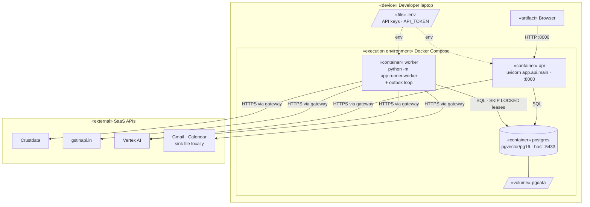
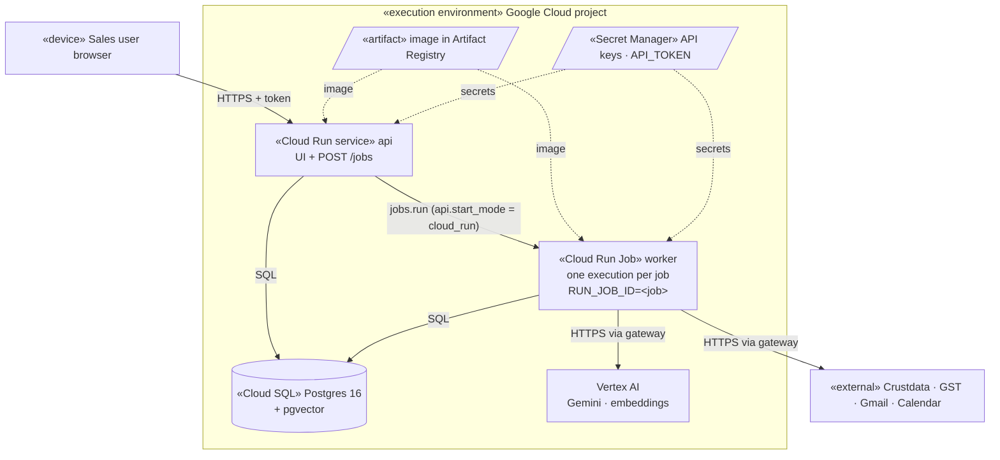
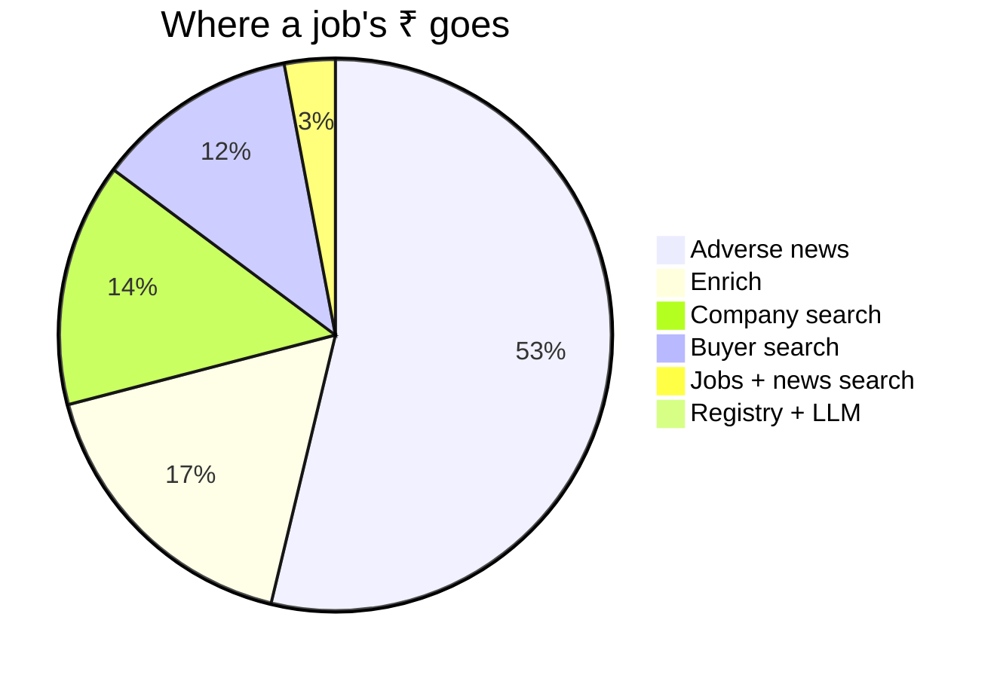
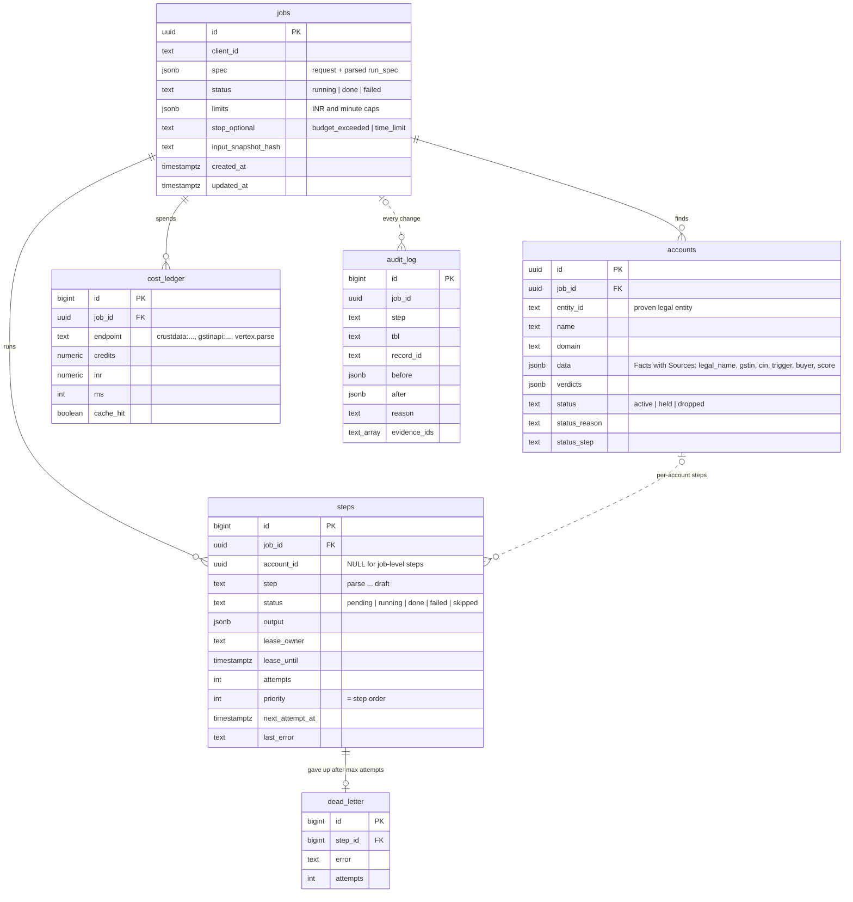
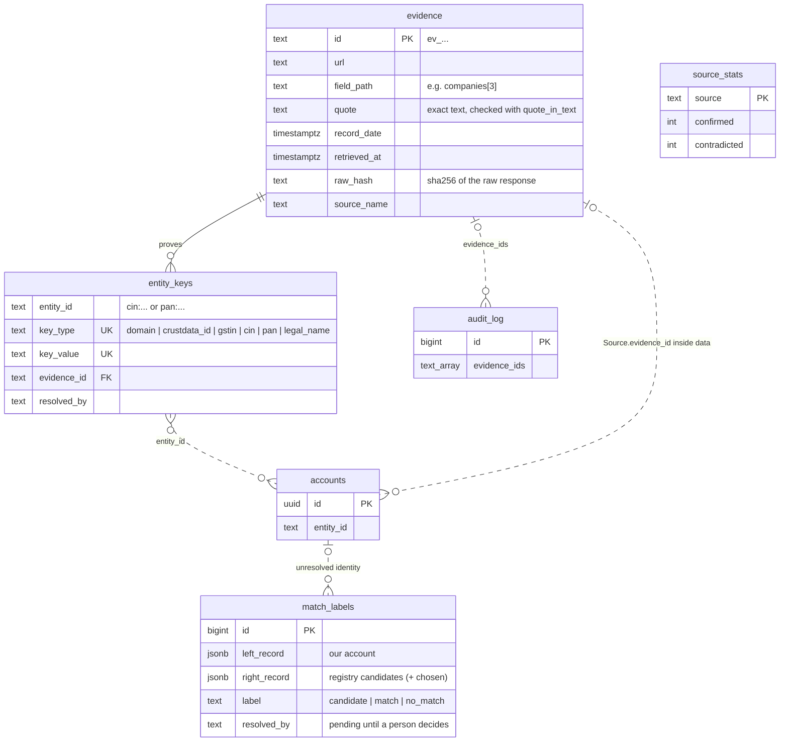
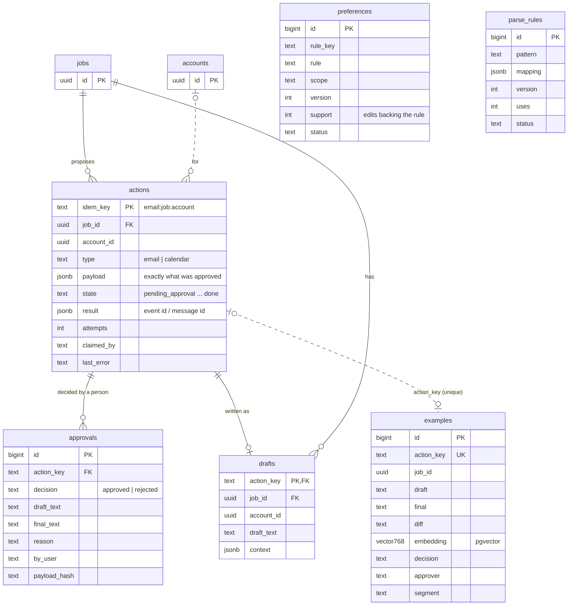
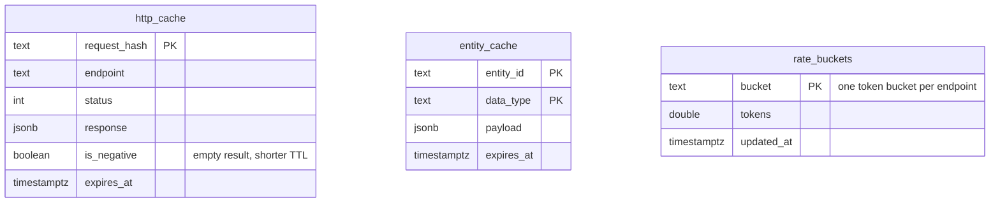

# ContextCon2026

▶ **[Demo video](https://drive.google.com/drive/folders/17TYBYaHp6nUgUnSjBplUOsu1EwaGt1w4)**

A revenue agent for an Indian 3PL. It finds companies that need a 3PL partner, proves they
are real, active and free of adverse news, finds a recent trigger and the right buyer, scores
the lead and drafts an email. A person approves before anything is sent.

## Architecture


Every fact carries a Source. Every state change writes an audit row. All limits live in
`config.yaml`.

## Deployment

UML deployment view: «device» and «execution environment» nodes hold the deployed
«artifact»s. One Docker image runs as both api and worker.

**Local (built; `docker compose up`)**



**Cloud (target, not provisioned yet: there are no deploy files in the repo)**



| | Local | Cloud |
|---|---|---|
| Start a job | api inserts the steps; the always-on worker claims them | api inserts the steps, then calls the Cloud Run Jobs `:run` API |
| Crash safety | step leases expire and are reclaimed | the same, inside the execution |
| State | the `pgdata` volume | Cloud SQL |

## Pipeline: rules, ML and LLM


| Kind | Where | Guard |
|---|---|---|
| 🤖 LLM (Gemini Flash) | parse, news, trigger, draft, reflect | must quote the source text (`quote_in_text`) |
| 📈 ML | identity matcher: logistic regression, isotonic calibration | p ≥ 0.9 match · ≤ 0.5 no match · else held |
| 🔢 Embeddings | nearest approved emails (pgvector cosine) | retrieval only |
| ⚙️ Plain code | which calls to make, how much to spend, every decision | config limits |

## Gateway and caching


| Data | Kept for |
|---|---|
| registry, news | 24 h |
| company, people | 7 days |
| empty answer | 6 h |
| errors | never cached |

## Duplicates


Actions are one per account: the key `email:<job>:<account>` means a restart can't send twice.

## Self-evolving drafts


## Business model and cost


Estimated cost of one full job at the config prices (`estimate_inr`, also shown on screen 1):

| Stage | Credits | ₹ |
|---|---:|---:|
| Discover: company search (3 pages) | 15.9 | 398 |
| Discover: jobs + news search | 3.3 | 83 |
| Adverse news (10 accounts × 1 search + 5 pages) | 60.0 | 1,500 |
| Enrich (8 accounts) | 19.2 | 480 |
| Buyer search (8 accounts) | 13.2 | 330 |
| Registry + LLM | | 28 |
| **Total (upper estimate)** | | **≈ 2,818** |



- **Main cost lever:** adverse news is about half the cost. Lowering `news.max_fetch` from 5 to 2 brings the job to about ₹2,070.
- **Repeat runs cost less:** cache hits cost ₹0, and the crosswalk reuses identity proof.
- **Hard cap:** `max_inr_per_job` (₹2,500). Past it, optional steps stop and the affected accounts are held, not guessed.
- **Price (planning assumption, not validated):** about ₹5,000 per job: about a 44% margin at the full ₹2,818 estimate, more on cached repeat runs.

## Web UI

`docker compose up -d --build`, then open http://localhost:8000/?token=<API_TOKEN>.
FastAPI renders the pages with Jinja2. HTMX is vendored in `app/api/static`, so there is no
JavaScript build step. The screens follow `docs/wireframes/wireframe.html`:

| # | Screen | Route |
|---|---|---|
| 1 | New request: text or kickoff JSON, limits and a cost estimate before submit | `GET /`, `POST /jobs` |
| 2 | Live progress, polled every 2 s | `GET /jobs/{id}/progress` |
| 3 | Account table: decision, score, top reasons, trust | `GET /jobs/{id}` |
| 4 | Evidence drawer: every Fact with its sources, plus the audit log | `GET /jobs/{id}/accounts/{aid}` |
| 5 | Approval queue: approve, edit and approve, or reject with a reason | `GET /approvals`, `POST /approvals/{key}` |
| 6 | Outcome: emails, meetings and the client output | `GET /jobs/{id}/outcome`, `GET /jobs/{id}/output` |
| 7 | Run log: audit log and cost ledger | `GET /jobs/{id}/log` |
| | Learned rules: enable, disable or roll back | `GET /preferences` |

The data routes return JSON when the client sends `Accept: application/json` or adds `?format=json`.

### Authentication (demo only)

There are no user accounts. Every route except `/health` needs one shared token, set in the
environment as `API_TOKEN`. Send it in one of these ways:
- an `X-API-Token` header;
- `Authorization: Bearer <token>`;
- `?token=<token>` once in the browser, which sets a cookie.

If `API_TOKEN` is not set, the UI is open and the API logs a warning at startup. This is
enough for a hackathon demo, not for production. Anyone with the token can approve emails, and
the approver's name is whatever the form sends.

## Ethics

**Contact data.** The buyer step stores only a person's name, job title, company, public
profile URL and the Source it came from. It never stores a personal email address or phone
number, even when a provider offers one. A business email or phone may be added only when the
source states it is published for business contact. Raw profiles are not kept: the evidence
row holds a hash of the record, so the claim can be checked against the provider later.

**Adverse news.** A possible issue (fraud, insolvency, regulatory action) never drops an
account automatically. The account is held and a person decides, because naming a company in
connection with wrongdoing is an ethics-sensitive call. When nothing is found, the output says
"no adverse news found" and cites the searches performed; it never calls a company "clean".

## Run it

### Local (docker compose)

```bash
docker compose up -d --build   # postgres (:5433) + api (:8000) + worker   (or: make up)
curl localhost:8000/health     # {"status":"ok","db":"ok"}
open http://localhost:8000      # web UI; open locally unless API_TOKEN is set in .env
                                # (then: /?token=<token> once, or header x-api-token)
```

`.env` holds `CRUSTDATA_API_KEY`, `GSTIN_API_KEY`, `GCP_PROJECT` (and optionally
`REGISTRY_API_KEY`). It is never committed or uploaded. The local worker polls for new jobs.
Emails and calendar invites go to a sink file (`var/outbox_sink.jsonl`) unless
`actions.email_mode` / `actions.calendar_mode` in `config.yaml` say otherwise.

### Cloud (GCP)

```bash
gcloud auth login && gcloud config set project <project-id>
make deploy                  # scripts/deploy.sh: asks before creating billable resources
```

This creates (or updates):
- Cloud SQL Postgres 16 (`db-f1-micro`) with pgvector. The worker applies `schema.sql` on start.
- Secret Manager entries `DB_PASSWORD`, `API_TOKEN` (both generated), plus `CRUSTDATA_API_KEY`
  and `GSTIN_API_KEY` from `.env`.
- Cloud Run service `api`, built from source.
- Cloud Run job `worker`, from the same image, running `python -m app.runner.worker --until-idle`.
  The API starts one execution per job with `RUN_JOB_ID` set (`START_MODE=cloud_run`).
- A service account with the roles `cloudsql.client`, `secretmanager.secretAccessor`,
  `aiplatform.user`, `run.invoker` and `logging.logWriter`, plus `run.jobsExecutorWithOverrides`
  on the worker job.

Logs are JSON lines, so Cloud Logging shows them as `jsonPayload` with `severity`. The saved
query "revagent: one job" filters on `jsonPayload.job_id`. Get the API token with
`gcloud secrets versions access latest --secret=API_TOKEN`. `make teardown` deletes the
Cloud SQL instance, service and job.

### Kill test

```bash
make kill-test
```

This hard-kills a worker in the middle of a step, restarts it, and checks that the step
resumes and nothing runs twice. It also crashes the outbox after an email or calendar
side effect but before mark-done, and checks that the restart sees the effect (409 or
already sent) and doesn't send again. It needs the compose Postgres.

## Data model

All state lives in Postgres 16 (`schema.sql`, applied on startup and safe to re-run). The
diagrams are split by area.

- **Solid lines** are real foreign keys.
- **Dashed lines** are links the code relies on but the schema doesn't enforce. Some are plain
  columns (`steps.account_id`, `actions.account_id`, `audit_log.job_id`). Others are ids inside
  JSON or arrays (`audit_log.evidence_ids`, the `sources` inside each fact in
  `accounts.data`).

### 1. Jobs, steps and accounts (the runner)

A job is one client request. The runner claims `steps` one at a time with a lease, so a
killed worker's step is picked up again. Job-level steps (parse, discover, dedup, pre_rank,
enrich) have `account_id = NULL`. `pre_rank` creates the `accounts`, and every per-account
step (identity, registry, news, trigger, buyer, score, draft) then gets its own `steps` row
for each account.



### 2. Evidence and identity

Every fact cites at least one `evidence` row: a URL or API field path plus the exact quote
and dates, and a hash of the raw response. `entity_keys` is the crosswalk from domain,
Crustdata id, GSTIN, CIN, PAN and legal name to one proven legal entity. A later account
that hits a known key reuses the proof without making any calls. Cases the rules can't
settle go to `match_labels` for a person, and resolved rows retrain the matcher.



### 3. Outreach and actions (exactly-once side effects)

Every email or calendar invite is an `actions` row keyed by an idempotency key, one per
job, account and type. It runs only after an `approvals` row exists, and only with the exact
payload that was approved (`payload_hash`). States: `pending_approval → approved →
executing → done | failed`, with `rejected` terminal. `drafts` keep what the model wrote.
`examples` (with pgvector embeddings) and `preferences` are what the drafter learns from
approvers' edits.



### 4. Gateway caches and rate limits (standalone)

These tables belong to `app/gateway`, the only code that calls outside APIs. They have no
foreign keys: rows are keyed by request hash, entity or bucket name, and expire on their own.


