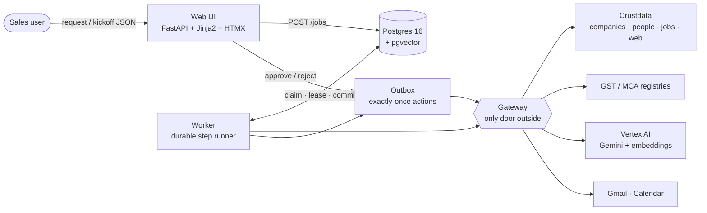
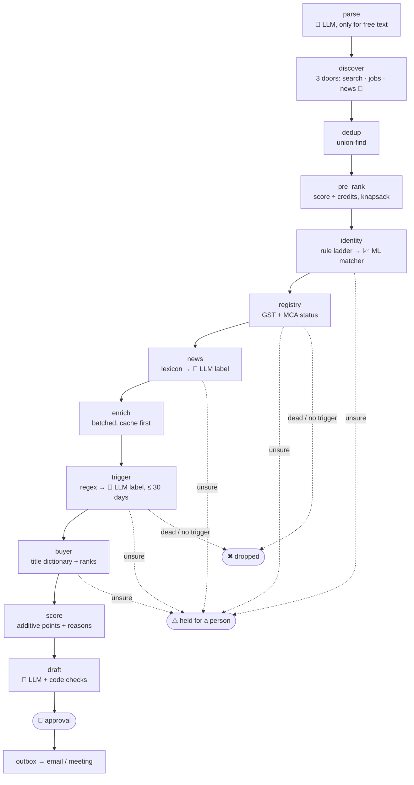
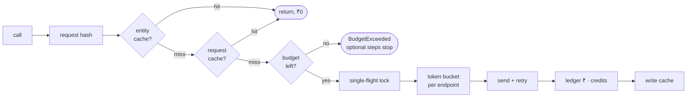
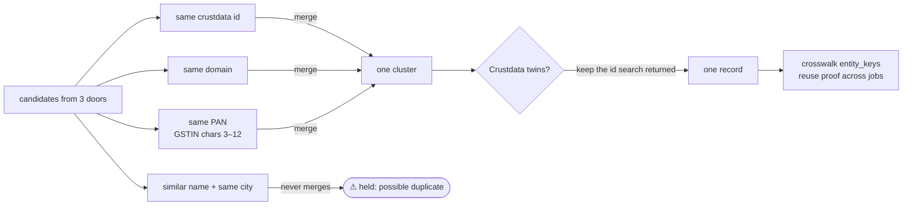
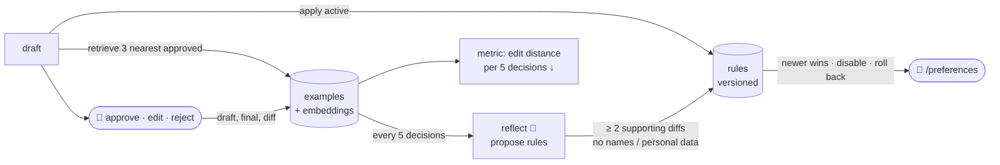
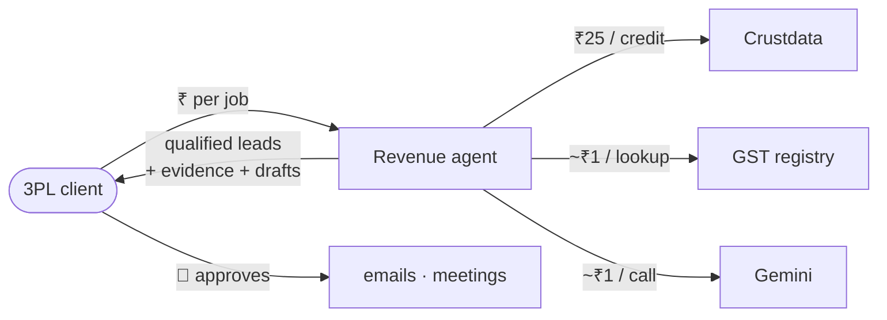
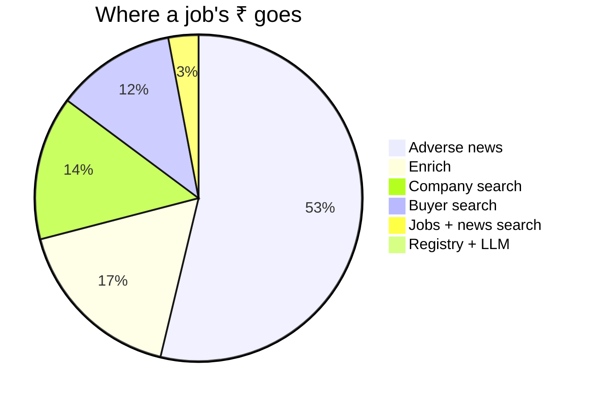

# ContextCon2026

A revenue agent for an Indian 3PL. It finds companies that need a 3PL partner, proves they
are real, active and free of adverse news, finds a recent trigger and the right buyer, scores
the lead and drafts an email. A person approves before anything is sent.

## Architecture

Every fact carries a Source. Every state change writes an audit row. All limits live in
`config.yaml`.

## Pipeline: rules, ML and LLM

| Kind | Where | Guard |
|---|---|---|
| 🤖 LLM (Gemini Flash) | parse, news, trigger, draft, reflect | must quote the source text (`quote_in_text`) |
| 📈 ML | identity matcher: logistic regression, isotonic calibration | p ≥ 0.9 match · ≤ 0.5 no match · else held |
| 🔢 Embeddings | nearest approved emails (pgvector cosine) | retrieval only |
| ⚙️ Plain code | which calls to make, how much to spend, every decision | config limits |

## Gateway and caching

| Data | Kept for |
|---|---|
| registry, news | 24 h |
| company, people | 7 days |
| empty answer | 6 h |
| errors | never cached |

## Duplicates

Actions are one per account: the key `email:<job>:<account>` means a restart can't send twice.

## Self-evolving drafts

## Business model and cost

Estimated cost of one full job at the config prices (`estimate_inr`, also shown on screen 1):

| Stage | Credits | ₹ |
|---|---:|---:|
| Discover: company search (3 pages) | 15.9 | 398 |
| Discover: jobs + news search | 3.3 | 83 |
| Adverse news (10 accounts × 1 search + 5 pages) | 60.0 | 1,500 |
| Enrich (8 accounts) | 19.2 | 480 |
| Buyer search (8 accounts) | 13.2 | 330 |
| Registry + LLM | | 28 |
| **Total (upper estimate)** | | **≈ 2,818** |

- **Main cost lever:** adverse news is about half the cost. Lowering `news.max_fetch` from 5 to 2 brings the job to about ₹2,070.
- **Repeat runs cost less:** cache hits cost ₹0, and the crosswalk reuses identity proof.
- **Hard cap:** `max_inr_per_job` (₹2,500). Past it, optional steps stop and the affected accounts are held, not guessed.
- **Price (planning assumption, not validated):** about ₹5,000 per job: about a 44% margin at the full ₹2,818 estimate, more on cached repeat runs.

## Web UI

`docker compose up -d --build`, then open http://localhost:8000/?token=<API_TOKEN>.
FastAPI renders the pages with Jinja2. HTMX is vendored in `app/api/static`, so there is no
JavaScript build step. The screens follow `docs/wireframes/wireframe.html`:

| # | Screen | Route |
|---|---|---|
| 1 | New request: text or kickoff JSON, limits and a cost estimate before submit | `GET /`, `POST /jobs` |
| 2 | Live progress, polled every 2 s | `GET /jobs/{id}/progress` |
| 3 | Account table: decision, score, top reasons, trust | `GET /jobs/{id}` |
| 4 | Evidence drawer: every Fact with its sources, plus the audit log | `GET /jobs/{id}/accounts/{aid}` |
| 5 | Approval queue: approve, edit and approve, or reject with a reason | `GET /approvals`, `POST /approvals/{key}` |
| 6 | Outcome: emails, meetings and the client output | `GET /jobs/{id}/outcome`, `GET /jobs/{id}/output` |
| 7 | Run log: audit log and cost ledger | `GET /jobs/{id}/log` |
| | Learned rules: enable, disable or roll back | `GET /preferences` |

The data routes return JSON when the client sends `Accept: application/json` or adds `?format=json`.

### Authentication (demo only)

There are no user accounts. Every route except `/health` needs one shared token, set in the
environment as `API_TOKEN`. Send it in one of these ways:
- an `X-API-Token` header;
- `Authorization: Bearer <token>`;
- `?token=<token>` once in the browser, which sets a cookie.

If `API_TOKEN` is not set, the UI is open and the API logs a warning at startup. This is
enough for a hackathon demo, not for production. Anyone with the token can approve emails, and
the approver's name is whatever the form sends.

## Ethics

**Contact data.** The buyer step stores only a person's name, job title, company, public
profile URL and the Source it came from. It never stores a personal email address or phone
number, even when a provider offers one. A business email or phone may be added only when the
source states it is published for business contact. Raw profiles are not kept: the evidence
row holds a hash of the record, so the claim can be checked against the provider later.

**Adverse news.** A possible issue (fraud, insolvency, regulatory action) never drops an
account automatically. The account is held and a person decides, because naming a company in
connection with wrongdoing is an ethics-sensitive call. When nothing is found, the output says
"no adverse news found" and cites the searches performed; it never calls a company "clean".
